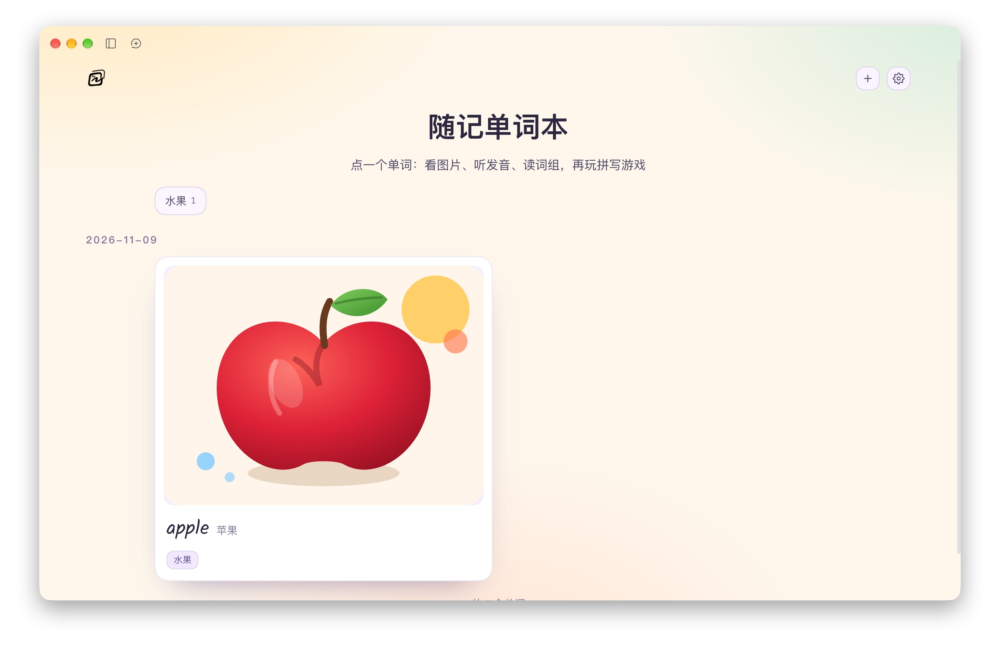
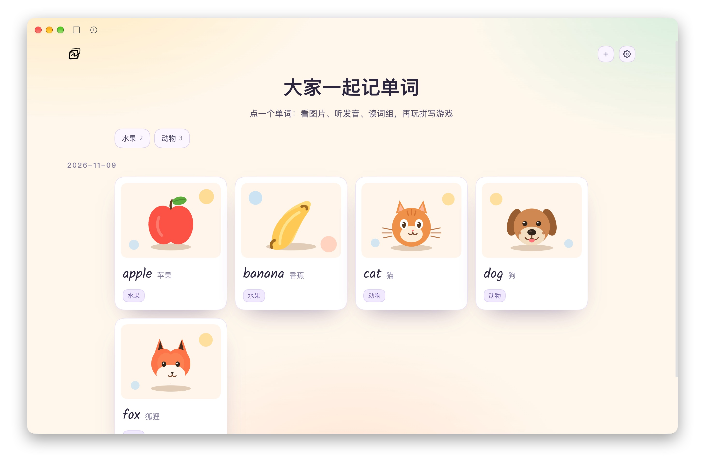
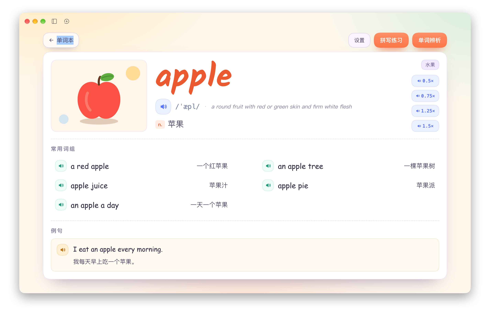
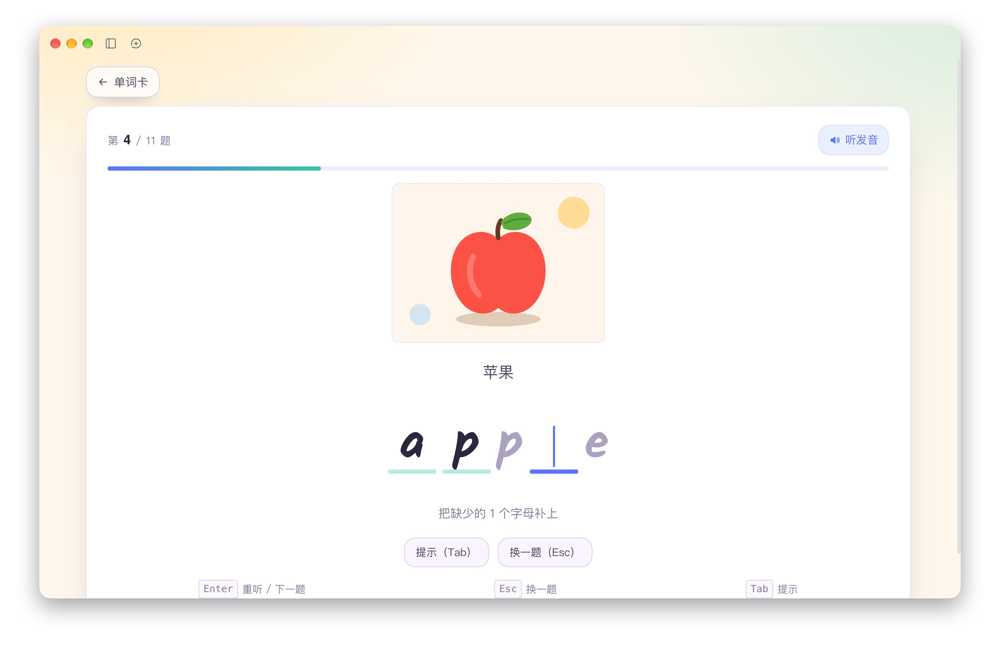
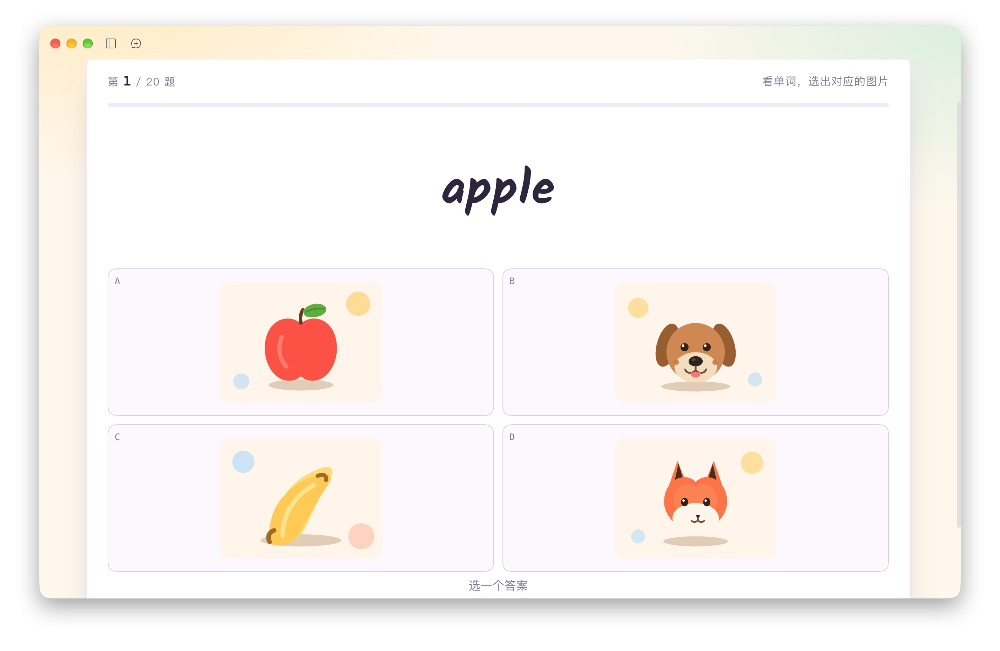
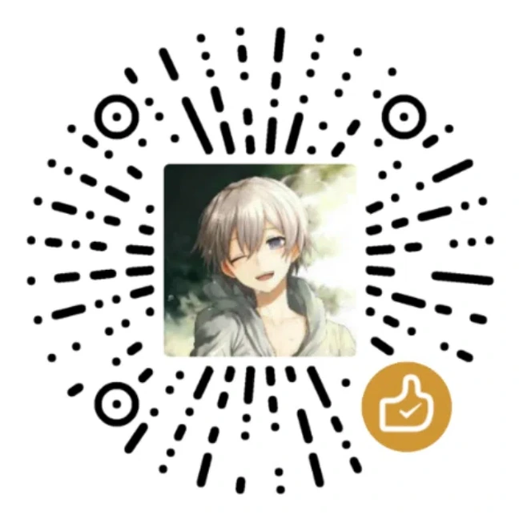

# 随记单词本

<p align="center">
  
</p>

<p>
  
  <a href="https://github.com/shallinta/dsh-agentic-word-book"></a>
  
  
  
</p>

一个词一页：插图、音标、发音、常用词组、例句都在上面，还有挖字母拼写练习和单词辨析选择题。切走再切回来，进度还在。

## 为什么要用

背单词的工具很多，难的是让每张卡都和你有关系。随记单词本从这几处入手。

### 一个词就是一页

插图、音标、发音、五条常用词组、例句，全在同一个页面里。有多个词性时，释义横向排开，每个词性各配一条例句。

### 练习围着这个词出

拼写练习只挖当前这个词的字母，单词辨析的题干和选项也都锚定这个词。刚看完的内容马上就能练。

### 加词只需要说一句

点「+单词」输入想加的内容，剩下的交给 AI：词条、插图、五条词组、例句和发音一次做完。

### 个性化主题配置

内置「晨光」「子夜」「雨滴」（青绿毛玻璃）三套主题，还能选「晨昏」（白天晨光、黑夜子夜）；首页标题和副标题可以分别对齐、配色，背景图能换也能调透明度；标签选项、每个词的插图和主音频，都在设定和卡片设置里。卡片可以多选打标，首页按标签筛。

### 数据是自己的

词条、插图、发音都是本地文件，住在一个目录里。插件包只带功能代码，不带词库。换电脑时把目录搬走即可。

## 演示视频

https://github.com/user-attachments/assets/c1208dbd-7f37-454f-a2a8-3db14179d032

从第一次使用开始，走完整个流程：安装插件、用「+单词」让 AI 建 5 张词卡、拼写练习、单词辨析、右键打标签。视频约 3 分钟。

## 截图

<table>
  <tr>
    <td align="center" width="50%">
      <br>
      <sub>首页 · 单词卡按日期分组，标签可以快速筛选</sub>
    </td>
    <td align="center" width="50%">
      <br>
      <sub>首页 · 一次加几个词，全部落在同一页</sub>
    </td>
  </tr>
  <tr>
    <td align="center">
      <br>
      <sub>单词卡 · 插图、音标、4 档倍速发音、5 条词组和 1 条例句</sub>
    </td>
    <td align="center">
      <br>
      <sub>拼写练习 · 挖掉几个字母，把单词补全</sub>
    </td>
  </tr>
  <tr>
    <td align="center">
      <br>
      <sub>单词辨析 · 12 种题型轮换，帮你记住单词、释义和发音</sub>
    </td>
    <td></td>
  </tr>
</table>

## 动图演示

「+单词」把词表交给 AI：写词条、画插图、生成发音，一次做完。


标题、副标题和每个词的插图也能换成自己喜欢的风格。


## 安装

把这段发给 DSH：

```text
请帮我安装 DSH 插件「随记单词本」：
源码仓库 https://github.com/shallinta/dsh-agentic-word-book
装好后左侧栏应该出现「随记单词本」，没出现就重启 DSH 或让模型检查插件状态。
```

本机已经有源码时，也可以从目录安装：让模型用 `plugin_manager` 的 `install_bundle`，target 指向本包目录。

包名是 `@suiji-ai/dsh-agentic-word-book`。上架插件市场后，也可以在 DSH 的插件市场里搜索「随记单词本」安装。

装好后左侧栏出现「随记单词本」；没出现就重启 DSH。

## 第一次使用

1. 打开左侧「随记单词本」。首次运行会自动建好单词本根目录（默认 `~/Documents/dsh/suiji-word-book/`）。
2. 点右上角齿轮，进「技能与权限」，点「安装技能」。
3. 把同一分区里的「+单词」按钮打开（默认是隐藏的）。
4. 回首页点「+单词」，输入几个想学的词，回车。插件会新建一个会话，让 AI 去做词卡。
5. 等 AI 做完，切回单词本刷新，卡片就出来了。

## 功能

| 模块 | 说明 |
|---|---|
| 首页 | 标题和副标题各自对齐、配色，背景图可换并调透明度；单词卡网格按日期 / 首字母 / 字母数量分组，可正序倒序；标签筛选和「已掌握」开关；右下角回到顶部 |
| 单词卡 | 大插图、手写体词头、音标、英文释义、多个词性横向展示、4 档倍速发音、五条常用词组、每个词性一条例句；内容在卡片内滚动 |
| 拼写练习 | 挖字母填词，`Tab` 提示、`Esc` 换题、`Enter` 重听/下一题，答完自动进下一题；题目区在卡片内滚动 |
| 单词辨析 | 12 种题型轮换，题干和选项都围绕当前这个词；题目区同样在卡片内滚动 |
| 标签 | 设定里配置标签选项，卡片右键多选打标，首页 chip 快速筛选；「已掌握」是固有标签，首页右侧开关控制显隐 |
| 单词设置 | 替换 / 恢复默认插图，替换 / 恢复默认主音频，勾选标签，删除单词（二次确认，连带词条和资源目录） |
| 设定 | 顶部标题固定，分组卡片：单词本（标题、副标题、对齐、颜色、背景图与透明度、主题、音频播放音量）、字体、浏览与排序、标签、目录、技能与权限、支持随记 |
| 字体 | 单词字体、词组例句字体各选一款；内置 Patrick Hand、Kalam、Comic Neue、Caveat 四款开源字体 |
| AI 加词 | 装好技能、打开「+单词」，输入内容原样交给 AI：它写词条、画插图、生成发音；新词卡的插图就是默认插图 |
| 技能更新 | 已安装的技能和当前版本不一致时，首页左上角图标后会出现「技能有更新，点此重装」 |

内置字体来自 Google Fonts，按 SIL Open Font License 1.1 分发，许可证文本在 `assets/fonts/`。

「+单词」依赖管理技能。技能装在 `~/.agents/skills/suiji-word-book/`，里面有两个跨平台脚本：`create-word.mjs` 建占位词条和占位图，`make-audio.mjs` 合成发音（macOS 用 `say` + `afconvert`，Windows 用 System.Speech）。装好技能后，也可以直接让 AI 用 `/suiji-word-book` 改词条、打标签、换插图或换主音频。

## 数据放在哪

```
~/Documents/dsh/suiji-word-book/          ← 单词本根目录，可在设定里改
  settings.json                           主题/标题/副标题（各自对齐和颜色）/背景图与透明度/音频播放音量/分组/排序/根目录/工作目录/是否显示 +单词/完全权限开关
  meta.json                               tagList 标签选项 + tags 每词标签
  words.json                              词条数组（一个词可以有多个词性，放在 senses 里）
  words/<slug>/                           单个单词的全部资源
    <slug>.svg                            默认插图      → words.json 的 art
    custom-<时间戳>.<ext>                 自定义插图    → words.json 的 customArt
    custom-audio-<时间戳>.<ext>           自定义主音频  → words.json 的 customWordAudio
    word.wav  p1..p5.wav  sentence.wav    发音
  background-<时间戳>.<ext>               首页背景图    → settings.json 的 backgroundImage
```

Windows 上默认在 `%USERPROFILE%\Documents\dsh\suiji-word-book\`。

整个根目录就是全部数据。复制它，或者放进私有 Git 仓库、可信云盘，就能带走所有单词。

## 数据与隐私

- 词条、插图、发音只存在本地根目录，插件不上传任何数据，也没有遥测。
- 只有点「+单词」让 AI 做词卡时，你输入的单词会发给 DSH 里配置的模型服务。
- 插件更新不会动根目录里的内容；备份就是复制目录。
- 词条里的文字和图片都是普通文件，随时可以用别的编辑器打开。

## 随记系列

如果你也想要一个本地优先的笔记插件，可以看看同系列的「随记」：[@suiji-ai/dsh-agentic-notes](https://github.com/shallinta/dsh-agentic-notes)。

## 支持随记

如果对你有帮助，可以请我喝杯咖啡，感谢支持~

<table>
  <tr>
    <td align="center"><strong>微信</strong></td>
    <td align="center"><strong>支付宝</strong></td>
  </tr>
  <tr>
    <td></td>
    <td></td>
  </tr>
</table>
